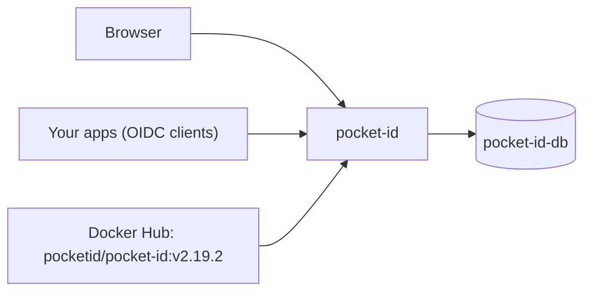

<div align="center">

# Pocket ID on Render

A simple OpenID Connect provider that signs users in with passkeys. Add single sign-on to your self-hosted apps without passwords. This repo is the Blueprint. The app runs from the official [Pocket ID](https://github.com/pocket-id/pocket-id) image.

<p>
  <a href="https://render.com/deploy-template/api/github/start?template_repo=pocket-id">
    
  </a>
</p>

<p>
  <a href="https://render.com">
    
  </a>
  <a href="https://github.com/pocket-id/pocket-id">
    
  </a>
  <a href="https://github.com/pocket-id/pocket-id/blob/main/LICENSE">
    
  </a>
</p>

</div>

## What This Template Shows

This repository does not contain the Pocket ID source. The service pulls the official image from Docker Hub at a pinned version. To upgrade, change the tag in [`render.yaml`](./render.yaml) and push.

| Piece | Role |
| --- | --- |
| **[Pocket ID](https://github.com/pocket-id/pocket-id)** | OIDC provider, admin UI, and passkey sign-in in one Go binary. |
| **`pocket-id`** ([Web Service](https://render.com/docs/web-services)) | The app. |
| **`pocket-id-db`** ([Render Postgres](https://render.com/docs/postgresql)) | Users, passkeys, OIDC clients, and uploaded images. |

## Architecture



### How It Works

1. Click **Deploy to Render**. The flow copies this repo into your GitHub account and applies [`render.yaml`](./render.yaml).
2. Render creates the database and generates `ENCRYPTION_KEY`. There is nothing to fill in.
3. Pocket ID creates its tables in Postgres and starts.
4. Open `/setup` and create the admin account with a passkey.

| Resource | Type | Plan | Notes |
| --- | --- | --- | --- |
| `pocket-id` | Web, image | Starter | Health: `/healthz`. Single instance. |
| `pocket-id-db` | Postgres 16 | Basic 256 MB | Internal connections only. Also stores uploads (`FILE_BACKEND=database`). |

Default region: **Oregon**.

## Quick Start

1. Click **Deploy to Render** above.
2. Wait until `pocket-id` is **Live**.
3. **Right away**, open `https://<pocket-id>.onrender.com/setup` and create the admin account. Until you do, anyone who opens that page can claim it.
4. In the admin UI, add an OIDC client for each app you want to sign in to.

```bash
curl -fsS "https://<pocket-id>.onrender.com/healthz"
```

> [!IMPORTANT]
> Passkeys are bound to the domain in `APP_URL`. If you plan to use a custom domain, add it and update `APP_URL` **before** anyone registers a passkey. Passkeys made on the `onrender.com` domain stop working after the switch.

## Migrating From Another Pocket ID

Pocket ID's `export` and `import` commands move all users, passkeys, OIDC clients, and settings. The import replaces the whole database, so skip `/setup`. Because the data lives in Postgres, you run the import from your old host, straight into `pocket-id-db`.

1. On the old instance, export:
   ```bash
   docker exec pocket-id /app/pocket-id export --path - > pocket-id-export.zip
   ```
   The Render instance must run the same Pocket ID version as the old one, or a newer one. Check with `/app/pocket-id version`.
2. On the `pocket-id` service's **Environment** page:
   - Set `ENCRYPTION_KEY` to the old instance's key. The export keeps secrets encrypted with it.
   - Set `APP_URL` to the old domain, then add that domain under **Settings → Custom Domains**. Passkeys and OIDC clients only work on the domain they were set up with.

   The service may fail to start after this, because its first boot encrypted a new signing key with the generated key. The import replaces that key.
3. On `pocket-id-db`, under **Info → Access Control**, allow your old host's public IP. Copy the **External Database URL**.
4. On the old host, run the import with the same image version:
   ```bash
   docker run --rm -i \
     -e DB_CONNECTION_STRING='<External Database URL>' \
     -e ENCRYPTION_KEY='<old key>' \
     -e FILE_BACKEND=database \
     pocketid/pocket-id:v2.19.2 \
     /app/pocket-id import --path - --yes --forcefully-acquire-lock < pocket-id-export.zip
   ```
   `--forcefully-acquire-lock` stops the Render instance while the import runs. Render restarts it, and it starts once the import releases the lock.
5. Remove your IP from **Access Control**, then point the domain's DNS at Render.

## Configuration

| Variable | Source | Description |
| --- | --- | --- |
| `ENCRYPTION_KEY` | Generated | Encrypts private keys and secrets in the database. Never change it. |
| `APP_URL` | Wired | The service's `RENDER_EXTERNAL_URL`. The OIDC issuer and passkey domain. |
| `DB_CONNECTION_STRING` | Wired | Internal URL of `pocket-id-db`. |
| `FILE_BACKEND` | Blueprint | `database`. Stores uploaded logos and profile pictures in Postgres, so there is no disk. |
| `TRUST_PROXY` | Blueprint | `true`. Reads client IPs from Render's proxy for audit logs and rate limiting. |
| `PORT` | Blueprint | `1411`. |
| `ANALYTICS_DISABLED` | Blueprint | `true`. Turns off the anonymous instance heartbeat. |
| `MAXMIND_LICENSE_KEY` | Optional | Adds IP geolocation to audit logs. See [`.env.example`](./.env.example). |

`generateValue` runs once, on the first Blueprint apply. Email (SMTP) is configured in the admin UI, not with env vars.

## Cost

Prices from [Render's pricing page](https://render.com/pricing).

| Resource | Approx. monthly |
| --- | ---: |
| `pocket-id` (Starter) | $7 |
| `pocket-id-db` (Basic 256 MB) | $6 |
| **Total** | **~$13** |

## Troubleshooting

| Problem | Solution |
| --- | --- |
| Passkey sign-in fails after adding a custom domain | Passkeys are bound to the old domain. Users must register new passkeys on the new domain. |
| OIDC clients reject the issuer | `APP_URL` must match the URL the clients use. Update it after you add a custom domain. |
| First deploy fails to connect to Postgres | The service started before `pocket-id-db` accepted connections. Wait for the database to be **Available** and click **Manual Deploy**. |

## Project Structure

```
render.yaml       Blueprint. One image-backed web service and Postgres.
README.md         This file
LICENSE           Wrapper license
.env.example      Optional extras
```

## Learn More

- [Blueprint spec](https://render.com/docs/blueprint-spec)
- [Pocket ID docs](https://pocket-id.org/docs)
- [Pocket ID on GitHub](https://github.com/pocket-id/pocket-id)

## License

[MIT](LICENSE) for this wrapper. Pocket ID is licensed under [BSD-2-Clause](https://github.com/pocket-id/pocket-id/blob/main/LICENSE).
