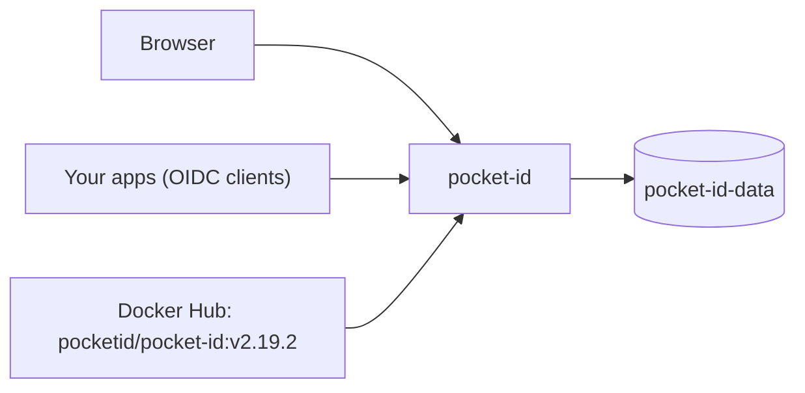

<div align="center">

# Pocket ID on Render

A simple OpenID Connect provider that signs users in with passkeys. Add single sign-on to your self-hosted apps without passwords. This repo is the Blueprint. The app runs from the official [Pocket ID](https://github.com/pocket-id/pocket-id) image.

<p>
  <a href="https://render.com/deploy-template/api/github/start?template_repo=pocket-id">
    
  </a>
</p>

<p>
  <a href="https://render.com">
    
  </a>
  <a href="https://github.com/pocket-id/pocket-id">
    
  </a>
  <a href="https://github.com/pocket-id/pocket-id/blob/main/LICENSE">
    
  </a>
</p>

</div>

## What This Template Shows

This repository does not contain the Pocket ID source. The service pulls the official image from Docker Hub at a pinned version. To upgrade, change the tag in [`render.yaml`](./render.yaml) and push.

| Piece | Role |
| --- | --- |
| **[Pocket ID](https://github.com/pocket-id/pocket-id)** | OIDC provider, admin UI, and passkey sign-in in one Go binary. |
| **`pocket-id`** ([Web Service](https://render.com/docs/web-services)) | The app. |
| **`pocket-id-data`** ([Persistent disk](https://render.com/docs/disks)) | The SQLite database and uploaded images at `/app/data`. |

## Architecture



### How It Works

1. Click **Deploy to Render**. The flow copies this repo into your GitHub account and applies [`render.yaml`](./render.yaml).
2. Render creates the disk and generates `ENCRYPTION_KEY`. There is nothing to fill in.
3. Pocket ID creates its SQLite database on the disk and starts.
4. Open `/setup` and create the admin account with a passkey.

| Resource | Type | Plan | Notes |
| --- | --- | --- | --- |
| `pocket-id` | Web, image | Starter | Disk at `/app/data`, 1 GB. Health: `/healthz`. Single instance. |

Default region: **Oregon**.

## Quick Start

1. Click **Deploy to Render** above.
2. Wait until `pocket-id` is **Live**.
3. **Right away**, open `https://<pocket-id>.onrender.com/setup` and create the admin account. Until you do, anyone who opens that page can claim it.
4. In the admin UI, add an OIDC client for each app you want to sign in to.

```bash
curl -fsS "https://<pocket-id>.onrender.com/healthz"
```

> [!IMPORTANT]
> Passkeys are bound to the domain in `APP_URL`. If you plan to use a custom domain, add it and update `APP_URL` **before** anyone registers a passkey. Passkeys made on the `onrender.com` domain stop working after the switch.

## Configuration

| Variable | Source | Description |
| --- | --- | --- |
| `ENCRYPTION_KEY` | Generated | Encrypts private keys and secrets in the database. Never change it. |
| `APP_URL` | Wired | The service's `RENDER_EXTERNAL_URL`. The OIDC issuer and passkey domain. |
| `TRUST_PROXY` | Blueprint | `true`. Reads client IPs from Render's proxy for audit logs and rate limiting. |
| `PORT` | Blueprint | `1411`. |
| `ANALYTICS_DISABLED` | Blueprint | `true`. Turns off the anonymous instance heartbeat. |
| `MAXMIND_LICENSE_KEY` | Optional | Adds IP geolocation to audit logs. See [`.env.example`](./.env.example). |

`generateValue` runs once, on the first Blueprint apply. Email (SMTP) is configured in the admin UI, not with env vars.

## Cost

Prices from [Render's pricing page](https://render.com/pricing).

| Resource | Approx. monthly |
| --- | ---: |
| `pocket-id` (Starter) | $7 |
| 1 GB disk | $0.25 |
| **Total** | **~$7.25** |

## Troubleshooting

| Problem | Solution |
| --- | --- |
| Passkey sign-in fails after adding a custom domain | Passkeys are bound to the old domain. Users must register new passkeys on the new domain. |
| OIDC clients reject the issuer | `APP_URL` must match the URL the clients use. Update it after you add a custom domain. |
| Users and clients disappear after a deploy | Confirm the disk is mounted at `/app/data`. |
| Deploy takes about a minute of downtime | Expected. A service with a disk stops the old instance before it starts the new one. |

## Project Structure

```
render.yaml       Blueprint. One image-backed web service with a disk.
README.md         This file
LICENSE           Wrapper license
.env.example      Optional extras
```

## Learn More

- [Blueprint spec](https://render.com/docs/blueprint-spec)
- [Pocket ID docs](https://pocket-id.org/docs)
- [Pocket ID on GitHub](https://github.com/pocket-id/pocket-id)

## License

[MIT](LICENSE) for this wrapper. Pocket ID is licensed under [BSD-2-Clause](https://github.com/pocket-id/pocket-id/blob/main/LICENSE).
